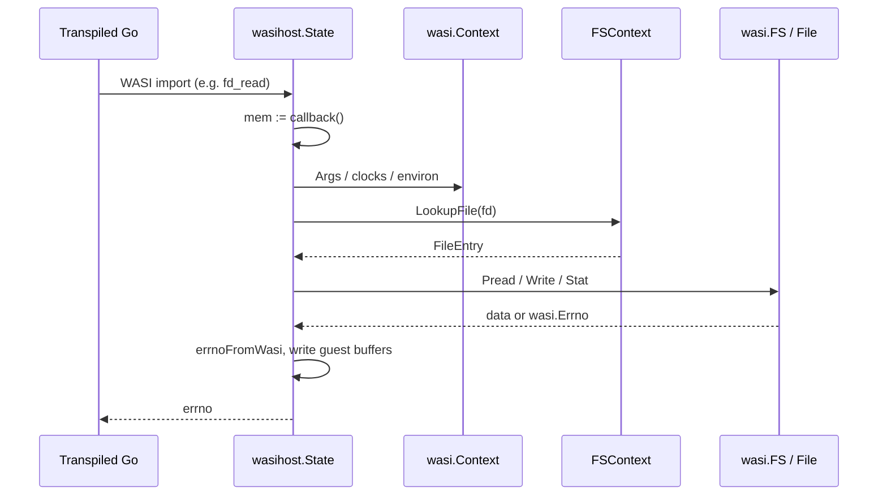
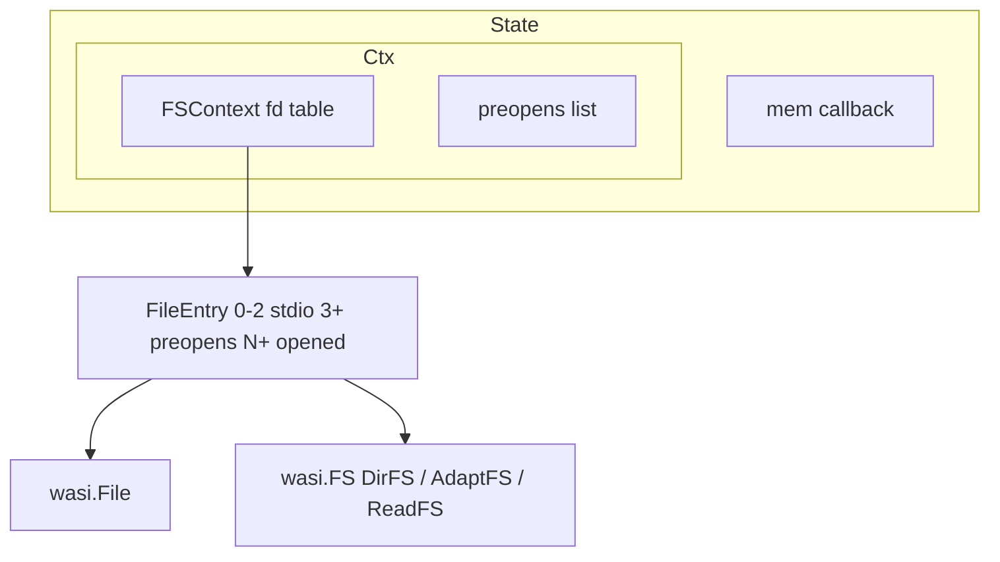

# Architecture

`wasm2go-wasi-host` has two main parts: the **`wasihost`** library (WASI Preview1 for wasm2go-generated Go) and the **`wasm2go-run`** CLI (transpile → wrap → build → run for wasi-testsuite and local development).

## Compliance

The authoritative check is the `wasi-testsuite` submodule running its full `wasm32-wasip1` inventory through `adapters/wasm2go.py` and this repository's `wasm2go-run`. All 72 Preview1 tests pass.

**Unit tests** (`go test ./...`) cover path confinement, rights, symlinks, poll, and filesystem mutations in-process — see `syscall_*_test.go`, `wasihost_*_test.go`, and `internal/wasi/*_test.go`. Policy: [TESTING.md](./TESTING.md).

**Integration tests** (`go test -tags=e2e ./...`) read `testdata/e2e_cases.json` via `e2e_inventory_test.go`: all 72 wasi-testsuite `wasm32-wasip1` binaries via `wasm2go-run` (parallel), plus `TestQualityGate`. Template/config guards run in unit tests (`guardrails_test.go`). The standalone script `scripts/e2e-wasip1.sh` runs the same inventory through the Python runner when needed.

## 1. `wasihost` package

### Role

`wasihost` implements **WASI snapshot-preview1** for a single wasm2go `Module` instance. The guest is native Go; the host reads and writes guest linear memory through a callback (`func() []byte`) re-invoked on every import so memory growth stays correct.

`State` satisfies the wasm2go-generated `X…` methods for `wasi_snapshot_preview1` and `env` (including `call_host_function`, which returns zero). Guest termination uses `proc_exit`, which panics with [`ExitError`](wasihost.go); embedders recover at the `_start` boundary.

### Core structures

- **`State`**: Thin syscall facade — guest memory callback (`mem`), runtime [`wasi.Context`](internal/wasi/context.go) (`ctx`), optional trace logging, and optional single-goroutine owner assertion (`assertOwner` / `ownerGID`; not exposed on `ModuleConfig` today).
- **`ModuleConfig` / `FSConfig`**: Immutable configuration builders in `wasihost_config.go` and `wasihost_fsconfig.go`. [`New`](wasihost.go) accepts `*ModuleConfig` only (no functional options). Clock hooks (`WithWalltime`, `WithNanotime`, `WithNanosleep`, `WithOsyield`) and `WithRandSource` feed [`wasi.NewContext`](internal/wasi/context.go).
- **`internal/wasi.Context`**: Built once by `wasi.NewContext` from `ModuleConfig` — args, environ, stdio, clocks, random source, preopen list, and **`FSContext`** (fd table).
- **`internal/wasi.FSContext`**: Sparse fd table (`LookupFile`, `OpenFile`, `CloseFile`, `Renumber`, …). Stdio fds 0–2 and preopen dirs 3+ are ordinary `FileEntry` values.
- **`internal/wasi.FileEntry`**: Open file description — `File` handle, `Offset` (read/write position), `RightsBase` / `RightsInheriting`, `GuestPath` for nested `path_open`, and backing `FS`. WASI Preview1 fd numbers index entries; `fd_renumber` moves entries and invalidates the source slot (POSIX open-file-description semantics for offset sharing). `fd_filestat_set_size` / `fd_filestat_set_times` call `fe.File.Truncate` / `Utimens` and map errno via `errnoFromWasi` for all file types.

`applyModuleConfig` only constructs `ctx` via `wasi.NewContext` and seeds preopen rights on `FileEntry` values; it does not maintain a parallel legacy fd table.

### Source file map

Portable `package wasihost` on **Linux** and **Darwin** (small build-tagged files for OS-specific behavior):

| Area | File |
|------|------|
| `State`, `New`, `lookupFD` | `wasihost.go` |
| `ModuleConfig`, `applyModuleConfig` | `wasihost_config.go` |
| `FSConfig`, mount builders | `wasihost_fsconfig.go` |
| FileEntry helpers (guest path, preopen index) | `wasihost_fe.go` |
| WASI errno / rights constants | `wasihost_const.go` |
| `mapOSError`, `errnoFromWasi` | `wasihost_errno.go` |
| Guest memory / string tables | `wasihost_mem.go` |
| Path resolution and confinement | `wasihost_path_resolve.go` |
| `path_open` | `wasihost_open.go` |
| `path_*` mutations, `path_rename` | `wasihost_path.go` |
| `fd_read` / `write` / `seek` / `readdir` | `wasihost_fd.go` |
| `fd_pread` / `pwrite`, fd stubs | `wasihost_fd_ext.go` |
| filestat / fdstat | `wasihost_filestat.go` |
| args / env / clock / poll / proc_exit | `wasihost_misc.go` |

Legacy fd-table adapters (`FSFileWrap`, `DirEntriesFile`, `wasiDirInfo`) were removed; open files use `internal/wasi/sysfs` (`osFile`, `fsFile`) via `wasi.File`.

| Concern | Linux | Darwin |
|---------|-------|--------|
| Access time from `Stat_t` | `atime_linux.go` | `atime_darwin.go` |
| Hard link at symlink inode (`path_link`) | `path_link_linux.go` | `path_link_darwin.go` |
| `path_rename` across devices | `path_rename_unix.go` | (same file, unix tag) |
| `path_rename` on other GOOS | — | `path_rename_other.go` |

`internal/wasi/` holds portable WASI types, `Context`, `FSContext`, `DirentCache`, and `sysfs/` adapters (`DirFS`, `ReadFS`, `AdaptFS`, `osFile`, `fsFile`) adapted from [wazero](https://github.com/tetratelabs/wazero) (Apache License 2.0; see [NOTICE](./NOTICE) and [licenses/APACHE-2.0.txt](./licenses/APACHE-2.0.txt)). Stdio implements `Pollable` where applicable; `poll_oneoff` consults `PollableFile` / `Pollable` before emitting fd read/write events. Path resolution and confinement remain in `wasihost_path_resolve.go` (project-specific, MIT).

### Syscall flow

### Filesystem layer

Access is **capability-oriented**: guests use **preopened directories** only—**read-only fs.FS preopens** or writable host mounts (plus fds opened beneath them). Each preopen has **one VFS backend**; writable host mounts do not embed a read-only `fs.FS` overlay. To expose both host files and embedded assets, configure separate preopens (for example `WithHostDirectoryPreopen` and `WithReadOnlyFS`). Configure mounts via `ModuleConfig.WithReadOnlyFS`, `WithHostDirectoryPreopen`, or `WithFS(NewFSConfig()…)`:

| Mount API | Backing | Mutations |
|-----------|---------|-----------|
| `WithReadOnlyFS` / `WithFSMount` | `sysfs.AdaptFS` (`fs.FS`) | Denied (`ENOSYS` / `EROFS` via `ReadFS`) |
| `WithHostDirectoryPreopen` / `WithDirMount` | `sysfs.DirFS` (host path) | Allowed under confinement |
| `WithReadOnlyDirMount` | `sysfs.ReadFS(DirFS)` | Read-only host dir |

Path opens and mutations go through `wasi.FS` / `wasi.File` where possible; writable host mounts still use host-path helpers for symlink follow / `EvalSymlinks` confinement (see [docs/path-confinement.md](./docs/path-confinement.md)). Directory `fd_readdir` parent (`..`) inode comes from VFS `Stat`/`Lstat` on the mount-relative parent path when available.

## 2. `wasm2go-run` CLI

Orchestrates one-shot execution of a `.wasm` file for tests and local runs.

### Pipeline

### Responsibilities

1. **CLI** (`config.go`): `-dir`, `-env`, `-cache off`, `-version`, guest args after `--`.
2. **Transpile** (`transpile.go`, `cache.go`): invoke `wasm2go`; optional tier-1 cache of transpiled `module.go` (keyed by WASM hash, wasm2go identity, post-process version). Compile always uses a fresh temp workspace.
3. **Wrapper** (`template.go`): `main.go` calling `wasihost.New` with a `NewModuleConfig()` builder chain (args, env, mounts, stdio) and `generated.New(state, state)`; recover `ExitError`.
4. **Build path** (`compile.go`): `WASM2GO_WASIHOST_PATH` or dev `replace` to this repo; `go mod tidy` + `go build`.
5. **Execute** (`execute.go`): run binary, propagate exit code, delete temp dir.

Environment variables: `WASM2GO_RUN_CACHE`, `WASM2GO_RUN_CACHE_DIR`, `WASM2GO_WASIHOST_PATH` (see `cmd/wasm2go-run/README.md`).

### Testsuite integration

`scripts/e2e-wasip1.sh` runs `wasi-testsuite/run-tests` with `adapters/wasm2go.py`. The adapter expects `wasm2go-run` on `PATH` or via `WASM2GO_RUN`.

Go-level integration tests load case lists from `testdata/e2e_cases.json` via `e2e_inventory_test.go` (helpers and `TestQualityGate` also use the `e2e` tag). They exercise individual wasi-testsuite binaries through `wasm2go-run` for granular failure reporting; `scripts/e2e-wasip1.sh` remains a backup full-inventory run.

## Concurrency

One `State` per guest instance, single goroutine. `State` is not safe for concurrent use. Optional `assertOwner` exists on `State` for internal debugging but has no public `ModuleConfig` hook.

## Related docs

- [README.md](./README.md) — install, usage, development
- [NOTICE](./NOTICE) — third-party attribution (wazero, Apache 2.0)
- [licenses/APACHE-2.0.txt](./licenses/APACHE-2.0.txt) — Apache License 2.0 text for adapted wazero code
- [docs/path-confinement.md](./docs/path-confinement.md) — preopen matching, lexical and symlink confinement
- [docs/porting-guidance-from-wazero.md](./docs/porting-guidance-from-wazero.md) — moving a wazero WASI embedding to wasm2go-wasi-host
- [cmd/wasm2go-run/README.md](./cmd/wasm2go-run/README.md) — CLI flags and cache
- [pkg.go.dev](https://pkg.go.dev/github.com/lbe/wasm2go-wasi-host) — generated API reference
