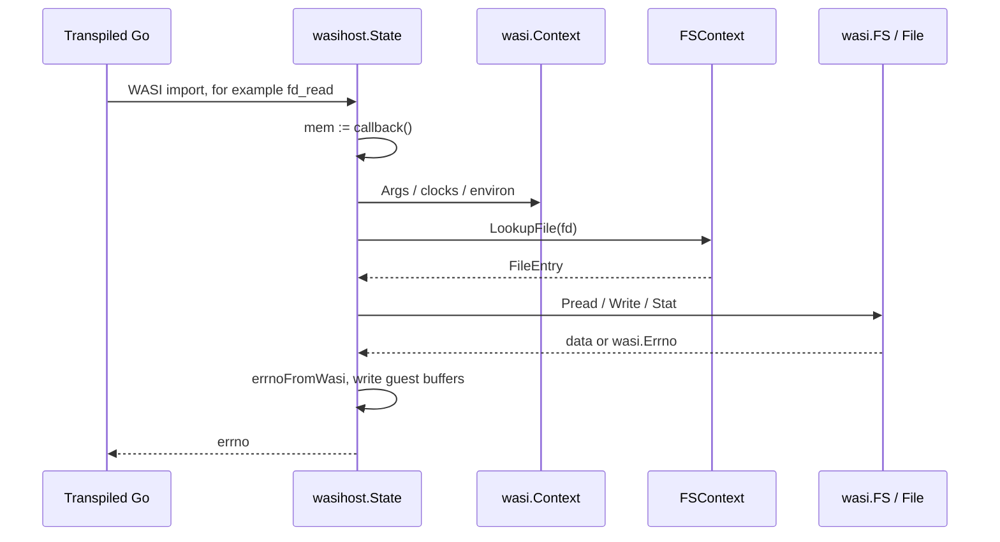
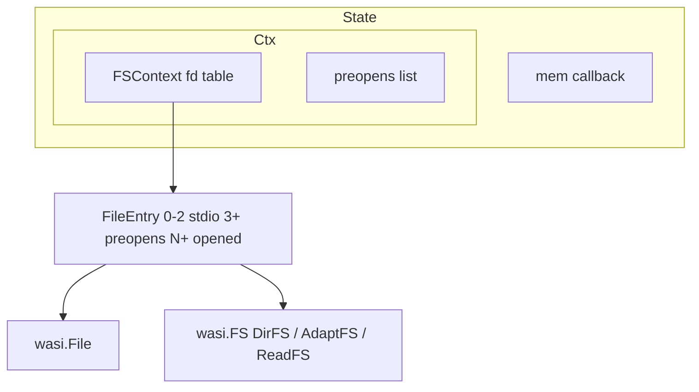

# Architecture

`wasm2go-wasi-host` has two parts. The `wasihost` library implements WASI Preview1 for wasm2go-generated Go. The `wasm2go-run` CLI transpiles, wraps, builds and runs a `.wasm` file, for wasi-testsuite and local development.

## Compliance

The compliance check is the `wasi-testsuite` submodule. It runs its full `wasm32-wasip1` inventory through `adapters/wasm2go.py` and this repository's `wasm2go-run`. All 72 Preview1 tests pass on Linux, macOS, Windows and FreeBSD.

Unit tests (`go test ./...`) run in-process. They cover path confinement, rights, symlinks, poll and filesystem mutations, in `syscall_*_test.go`, `wasihost_*_test.go` and `internal/wasi/*_test.go`. The policy is in [TESTING.md](./TESTING.md).

Integration tests (`go test -tags=e2e ./...`) read `testdata/e2e_cases.json` through `e2e_inventory_test.go`. They run all 72 wasi-testsuite `wasm32-wasip1` binaries through `wasm2go-run` in parallel, plus `TestQualityGate`. `guardrails_test.go` checks the template and configuration in the unit tier. `scripts/e2e-wasip1.sh` runs the same inventory through the Python runner.

## 1. `wasihost` package

### Role

`wasihost` implements WASI snapshot-preview1 for one wasm2go `Module` instance. The guest is native Go. The host reads and writes guest linear memory through a callback, `func() []byte`. The host calls it on every import, so it sees memory after the guest grows it.

`State` implements the wasm2go-generated `X` methods for `wasi_snapshot_preview1` and `env`. `env.call_host_function` returns zero. `proc_exit` ends the guest by panicking with [`ExitError`](wasihost.go). Embedders recover it at the `_start` call.

### Core structures

- `State` handles the syscalls. It holds the guest memory callback (`mem`), the runtime [`wasi.Context`](internal/wasi/context.go) (`ctx`), optional trace logging, and an optional check that one goroutine owns it (`assertOwner`, `ownerGID`). `ModuleConfig` does not expose the owner check.
- `ModuleConfig` and `FSConfig` are immutable configuration builders, in `wasihost_config.go` and `wasihost_fsconfig.go`. [`New`](wasihost.go) takes a `*ModuleConfig`. The clock hooks `WithWalltime`, `WithNanotime`, `WithNanosleep` and `WithOsyield`, and `WithRandSource`, pass their values to [`wasi.NewContext`](internal/wasi/context.go).
- `internal/wasi.Context` is built once by `wasi.NewContext` from `ModuleConfig`. It holds args, environment, stdio, clocks, the random source, the preopen list, and the `FSContext` fd table.
- `internal/wasi.FSContext` is a sparse fd table with `LookupFile`, `OpenFile`, `CloseFile` and `Renumber`. Stdio fds 0 to 2 and preopen directories from fd 3 are ordinary `FileEntry` values.
- `internal/wasi.FileEntry` is an open file description. It holds the `File` handle, the read and write `Offset`, `RightsBase` and `RightsInheriting`, the `GuestPath` used by nested `path_open`, and the backing `FS`. WASI fd numbers index the entries. `fd_renumber` moves an entry and frees the source slot. This follows POSIX open file description semantics for offset sharing. `fd_filestat_set_size` and `fd_filestat_set_times` call `fe.File.Truncate` and `Utimens`, and map the errno through `errnoFromWasi`.

`applyModuleConfig` builds `ctx` with `wasi.NewContext` and sets preopen rights on the `FileEntry` values. It keeps no other fd table.

### Source file map

| Area | File |
|------|------|
| `State`, `New`, `lookupFD` | `wasihost.go` |
| `ModuleConfig`, `applyModuleConfig` | `wasihost_config.go` |
| `FSConfig`, mount builders | `wasihost_fsconfig.go` |
| FileEntry helpers for guest path and preopen index | `wasihost_fe.go` |
| WASI errno and rights constants | `wasihost_const.go` |
| `mapOSError`, `errnoFromWasi` | `wasihost_errno.go` |
| Guest memory and string tables | `wasihost_mem.go` |
| Path resolution and confinement | `wasihost_path_resolve.go` |
| `path_open` | `wasihost_open.go` |
| `path_*` mutations, `path_rename` | `wasihost_path.go` |
| `fd_read`, `fd_write`, `fd_seek`, `fd_readdir` | `wasihost_fd.go` |
| `fd_pread`, `fd_pwrite`, fd stubs | `wasihost_fd_ext.go` |
| filestat and fdstat | `wasihost_filestat.go` |
| args, environment, clocks, poll, `proc_exit` | `wasihost_misc.go` |

Open files use `internal/wasi/sysfs` (`osFile`, `fsFile`) through the `wasi.File` interface.

### Per-OS code

The code builds and is tested on Linux, macOS, Windows and FreeBSD. OS-specific code is in build-tagged files. Files tagged `unix` apply to Linux, macOS and FreeBSD. Paths under `sysfs/` are in `internal/wasi/sysfs/`.

| Concern | Linux, macOS, FreeBSD | Windows |
|---------|-----------------------|---------|
| Host error to WASI errno | `internal/wasi/error_other.go` | `internal/wasi/error_windows.go` |
| Stat fields | `internal/wasi/stat_unix.go`, `stat_linux.go` on Linux, `stat_syscall_unix.go` elsewhere | `internal/wasi/stat_windows.go` |
| Open flags | `sysfs/open_file_unix.go` on Linux and macOS, `sysfs/open_file_freebsd.go` on FreeBSD | `sysfs/open_file_windows.go` |
| File times | `sysfs/futimens.go` with `futimens_linux.go`, `futimens_darwin.go` or `futimens_freebsd.go` | `sysfs/futimens_windows.go` |
| Hard link and set times without following a symlink | `sysfs/hostpath_unix.go` | `sysfs/hostpath_windows.go` |
| Inode numbers | `sysfs/ino_unix.go` | `sysfs/ino_windows.go` |
| Non-blocking I/O | `sysfs/nonblock_unix.go` | `sysfs/nonblock_windows.go` |
| `poll_oneoff` readiness | `sysfs/poll_unix.go` | `sysfs/poll_windows.go` |
| Rename and unlink | `sysfs/rename_unix.go`, `sysfs/unlink_unix.go` | `sysfs/rename_windows.go`, `sysfs/unlink_windows.go` |
| `fd_sync`, `fd_datasync` | `sysfs/sync.go`, `sysfs/datasync.go` | `sysfs/sync_windows.go`, `sysfs/datasync_windows.go` |
| Guest path check | `sysfs/guestpath_other.go` | `sysfs/guestpath_windows.go` |
| `path_rename` between preopens | `path_rename_unix.go` on Linux and macOS, `path_rename_other.go` on FreeBSD | `path_rename_other.go` |
| `wasm2go-run` cache lock | `cmd/wasm2go-run/lock_unix.go` | `cmd/wasm2go-run/lock_windows.go` |
| `wasm2go-run` executable name | `cmd/wasm2go-run/exe_other.go` | `cmd/wasm2go-run/exe_windows.go` |

On other OSes the code compiles against fallback files (`*_unsupported.go`, `cmd/wasm2go-run/lock_other.go`). These return `ENOSYS`, or do nothing for the cache lock. The limitations on each supported OS are listed in [README.md](./README.md#supported-platforms).

`internal/wasi/` holds the WASI types, `Context`, `FSContext`, `DirentCache`, and the `sysfs/` adapters `DirFS`, `ReadFS`, `AdaptFS`, `osFile` and `fsFile`. This code is adapted from [wazero](https://github.com/tetratelabs/wazero) under the Apache License 2.0. See [NOTICE](./NOTICE) and [licenses/APACHE-2.0.txt](./licenses/APACHE-2.0.txt). Stdio implements `Pollable` where it applies. `poll_oneoff` calls `PollableFile` or `Pollable` before it emits an fd read or write event. Path resolution and confinement are in `wasihost_path_resolve.go`, which is project code under the MIT license.

### Syscall flow

### Filesystem layer

The guest can use only preopened directories and the fds opened beneath them. Each preopen is one of the read-only fs.FS preopens or a writable host mount, and has one VFS backend. A writable host mount has no read-only `fs.FS` overlay. To expose both host files and embedded assets, configure separate preopens, for example with `WithHostDirectoryPreopen` and `WithReadOnlyFS`. Configure mounts with `ModuleConfig.WithReadOnlyFS`, `WithHostDirectoryPreopen`, or `WithFS(NewFSConfig()...)`:

| Mount API | Backing | Mutations |
|-----------|---------|-----------|
| `WithReadOnlyFS`, `WithFSMount` | `sysfs.AdaptFS` over an `fs.FS` | Denied with `ENOSYS` or `EROFS` through `ReadFS` |
| `WithHostDirectoryPreopen`, `WithDirMount` | `sysfs.DirFS` over a host path | Allowed inside the confined root |
| `WithReadOnlyDirMount` | `sysfs.ReadFS(DirFS)` | Denied; the host directory is read-only |

Path opens and mutations go through `wasi.FS` and `wasi.File` where possible. Writable host mounts still use host path helpers to follow symlinks and to check confinement with `EvalSymlinks`. See [docs/path-confinement.md](./docs/path-confinement.md). For the `..` entry, `fd_readdir` takes the inode from VFS `Stat` or `Lstat` of the parent path inside the mount, when the parent is inside it.

## 2. `wasm2go-run` CLI

`wasm2go-run` runs one `.wasm` file, for tests and local use.

### Pipeline

### Steps

1. Parse the command line in `config.go`: `-dir`, `-env`, `-cache off`, `-version`, and guest arguments after `--`.
2. Transpile in `transpile.go` and `cache.go`. `wasm2go-run` calls `wasm2go` and can cache the transpiled `module.go`. The cache key is the WASM hash, the wasm2go identity and the post-process version. Each compile still uses a new temporary directory.
3. Generate the wrapper in `template.go`. The generated `main.go` calls `wasihost.New` with a `NewModuleConfig()` builder chain for args, environment, mounts and stdio, calls `generated.New(state, state)`, and recovers `ExitError`.
4. Build in `compile.go`. The generated `go.mod` points at `WASM2GO_WASIHOST_PATH`, or at this repository in a development build, through `replace`. Then `go mod tidy` and `go build` run.
5. Run in `execute.go`. `wasm2go-run` runs the binary, exits with its exit code, and deletes the temporary directory.

Environment variables: `WASM2GO_RUN_CACHE`, `WASM2GO_RUN_CACHE_DIR` and `WASM2GO_WASIHOST_PATH`. See `cmd/wasm2go-run/README.md`.

### Testsuite integration

`scripts/e2e-wasip1.sh` runs `wasi-testsuite/run-tests` with `adapters/wasm2go.py`. The adapter finds `wasm2go-run` through `WASM2GO_RUN` or on `PATH`.

The Go integration tests load their cases from `testdata/e2e_cases.json` through `e2e_inventory_test.go`. The helpers and `TestQualityGate` also have the `e2e` tag. These tests run each wasi-testsuite binary through `wasm2go-run` and report each failure separately. `scripts/e2e-wasip1.sh` is a second way to run the full inventory.

## Concurrency

Use one `State` per guest instance, from one goroutine. `State` is not safe for concurrent use. `State` has an `assertOwner` check for internal debugging, and `ModuleConfig` does not expose it.

## Related docs

- [README.md](./README.md): installation, usage, supported platforms, development
- [NOTICE](./NOTICE): third-party attribution for wazero under Apache 2.0
- [licenses/APACHE-2.0.txt](./licenses/APACHE-2.0.txt): Apache License 2.0 text for the adapted wazero code
- [docs/path-confinement.md](./docs/path-confinement.md): preopen matching, lexical and symlink confinement
- [docs/porting-guidance-from-wazero.md](./docs/porting-guidance-from-wazero.md): moving a wazero WASI embedding to wasm2go-wasi-host
- [cmd/wasm2go-run/README.md](./cmd/wasm2go-run/README.md): CLI flags and cache
- [pkg.go.dev](https://pkg.go.dev/github.com/lbe/wasm2go-wasi-host): API reference
