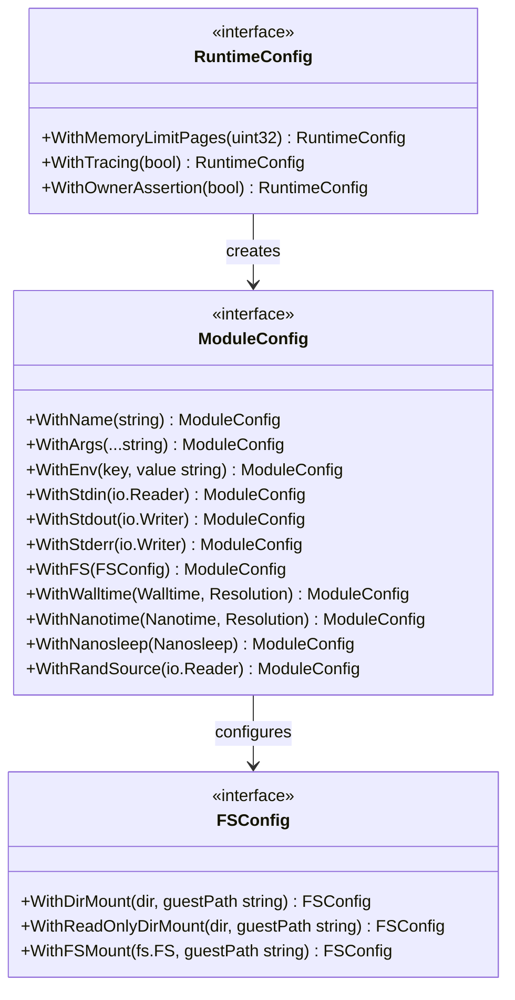
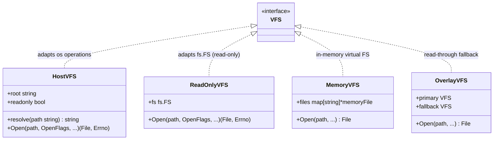
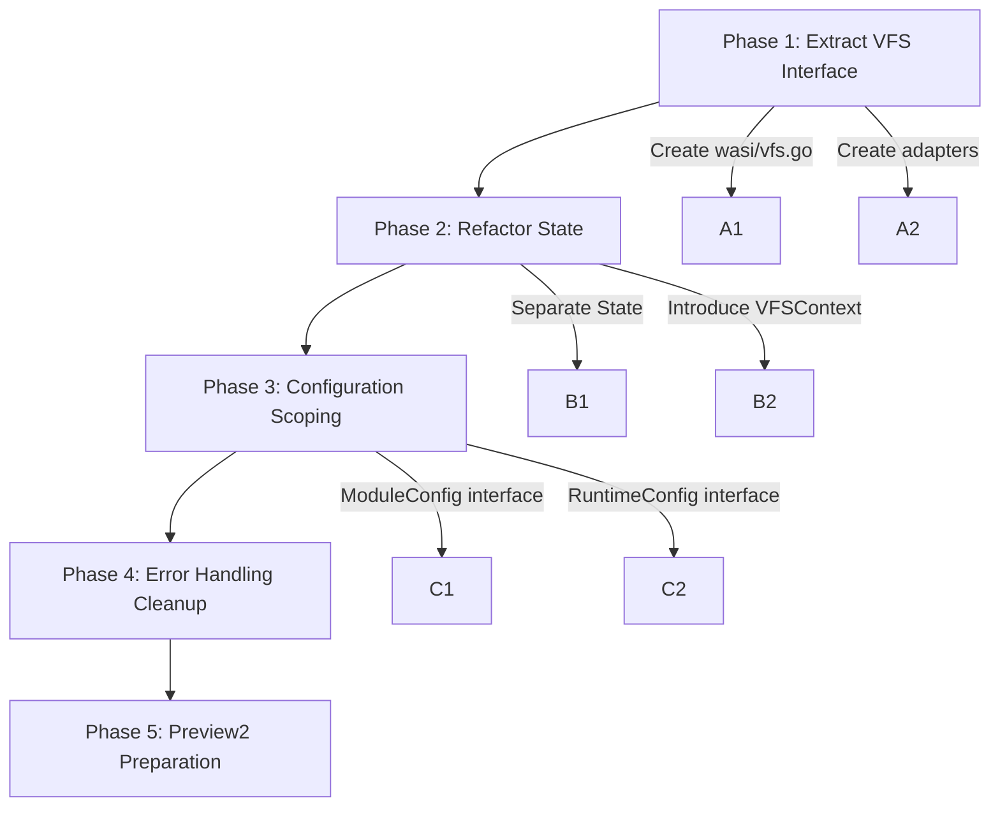

# Design Improvements: Configuration Management and Abstraction Layer

## Executive Summary

This document outlines the foundational architectural changes needed to improve the reliability and security of `wasm2go-wasi-host` by decoupling configuration from WASI specification concerns and introducing a WASI-native internal VFS abstraction. These changes follow wazero's lessons learned and prepare the codebase for WASI Preview2 evolution.

## Current State Analysis

### Existing Configuration Pattern

The current `State` struct combines:

1. **WASI-specific state**: FD table, args, env, preopens
2. **WASI-agnostic configuration**: stdin/stdout/stderr, clock behavior, tracing
3. **Mount management**: Direct coupling to `fs.FS` and `hostRoot` paths

```go
// Current State (wasihost.go)
type State struct {
    mem         func() []byte
    fds         []fdEntry
    preopens    []fdEntry
    mounts      []mountEntry          // Direct fs.FS coupling
    env         []string
    args        []string
    startTime   time.Time             // Internal clock state
    stdin       io.Reader
    stdout      io.Writer
    stderr      io.Writer
    trace       bool
    assertOwner bool
}
```

### Problems Identified

From the comparison document and wazero analysis:

1. **No abstraction boundary**: `fs.FS` is used directly throughout, causing impedance mismatch between Go's `fs.FS` semantics and WASI syscall requirements (inode identity, descriptor semantics, symlink policies)

2. **Configuration coupled to WASI Preview1**: All configuration options are embedded in `State`, making it difficult to transition to Preview2 or other WASI variants

3. **Silent no-op success**: Operations like `fd_filestat_set_size` return `ESUCCESS` on read-only mounts instead of explicit errors, creating semantic ambiguity

4. **No preparatory VFS layer**: The codebase already shows compensation logic (overlay fallbacks, custom offset tracking, symlink special-casing) indicating abstraction pressure

## Recommended Architectural Changes

### 1. Configuration Scoping (Following wazero's Two-Level Pattern)

Introduce a two-level configuration hierarchy that separates:

- **Runtime-level configuration**: Memory limits, debugging, tracing, concurrency model
- **Module-level configuration**: Per-instance resources (stdio, args, env, filesystems, clocks)

This allows:
- Configuration parsing independent of validation
- Safe sharing of configuration across goroutines
- Preparation for concurrent module instantiation



### 2. WASI-Native VFS Abstraction Layer

Create an internal `wasi.VFS` interface that abstracts filesystem operations with WASI semantics:

```go
// wasi/vfs.go - Internal WASI-native filesystem abstraction
package wasi

import "io/fs"

// VFS abstracts file system operations for WASI, independent of Go's fs.FS.
// This addresses the impedance mismatch documented in the comparison analysis.
type VFS interface {
    // Open opens a file at the given path with WASI-style flags.
    Open(path string, flags OpenFlags, perm fs.FileMode) (File, Errno)
    
    // Lstat gets file status without following symbolic links.
    Lstat(path string) (Stat_t, Errno)
    
    // Stat gets file status.
    Stat(path string) (Stat_t, Errno)
    
    // Mkdir makes a directory.
    Mkdir(path string, perm fs.FileMode) Errno
    
    // Chmod changes the mode of the file.
    Chmod(path string, perm fs.FileMode) Errno
    
    // Rename renames file or directory.
    Rename(from, to string) Errno
    
    // Rmdir removes a directory.
    Rmdir(path string) Errno
    
    // Unlink removes a directory entry.
    Unlink(path string) Errno
    
    // Link creates a hard link.
    Link(oldPath, newPath string) Errno
    
    // Symlink creates a symbolic link.
    Symlink(oldPath, linkName string) Errno
    
    // Readlink reads the contents of a symbolic link.
    Readlink(path string) (string, Errno)
    
    // Utimens sets access and modification times.
    Utimens(path string, atim, mtim int64) Errno
    
    // PathFor returns the underlying host path for preopen resolution.
    // Returns empty string for virtual filesystems.
    PathFor(guestPath string) string
}

// File represents an open file with WASI-style operations.
type File interface {
    Read(p []byte) (n int, err error)
    Write(p []byte) (n int, err error)
    Close() error
    Stat() (Stat_t, Errno)
    ReadAt(p []byte, off int64) (n int, err error)
    WriteAt(p []byte, off int64) (n int, err error)
    Seek(offset int64, whence int) (int64, Errno)
    Sync() Errno
}

// Stat_t is a platform-independent file stat structure.
type Stat_t struct {
    Dev     uint64
    Ino     uint64
    Mode    fs.FileMode
    NLink   uint64
    Size    int64
    Atim    int64  // access time (nanoseconds)
    Mtim    int64  // modification time (nanoseconds)
    Ctim    int64  // change time (nanoseconds)
}

// OpenFlags represents WASI-style open flags.
type OpenFlags uint32

const (
    O_RDONLY OpenFlags = 1 << iota
    O_WRONLY
    O_RDWR
    O_CREAT
    O_TRUNC
    O_EXCL
    O_DIRECTORY
)
```

### 3. VFS Implementation Adapters

Adapt different backing stores to the VFS interface:



### 4. State Refactoring

Separate the `State` into distinct concerns:

```go
// Proposed refactored structure
type State struct {
    // WASI-agnostic, set at construction
    mem        func() []byte
    config     *ModuleConfigImpl
    
    // WASI-specific, runtime state
    fds        []fdEntry
    startTime  time.Time
    trace      bool
    assertOwner bool
    ownerGID   uint64
    
    // VFS context (replaces direct mount coupling)
    vfs        VFSContext
}

// ModuleConfig holds immutable configuration.
type ModuleConfigImpl struct {
    name            string
    args            [][]byte
    environ         [][]byte
    stdin           io.Reader
    stdout          io.Writer
    stderr          io.Writer
    randSource      io.Reader
    walltime        Walltime
    nanotime        Nanotime
    nanosleep       Nanosleep
    osyield         Osyield
    fsConfig        FSConfig
}

// VFSContext manages the VFS abstraction.
type VFSContext struct {
    // fd 0-2 are stdio
    stdinFile  *FileEntry
    stdoutFile *FileEntry
    stderrFile *FileEntry
    
    // fd >= 3 are preopens and opened files
    fileTable  descriptor.Table[int32, *FileEntry]
    
    // Preopened VFS instances with their guest paths
    preopens   []PreopenEntry
}

type PreopenEntry struct {
    VFS    VFS
    Path   string     // guest path (e.g., "/")
    FD     int32      // assigned file descriptor
}

type FileEntry struct {
    VFS       VFS        // owning VFS
    File      File       // opened file
    Path      string     // guest path
    Offset    int64      // WASI fd offset (owned by this entry for single-threaded semantics)
    RightsBase uint64
    RightsInheriting uint64
    Flags     uint16
}
```

### 5. Explicit Error Handling Strategy

Replace "ESUCCESS without mutation" with explicit error codes:

| Operation | Current Behavior | Recommended |
|-----------|-----------------|-------------|
| `fd_filestat_set_size` on read-only VFS | ESUCCESS (no-op) | EROFS or ENOTSUP |
| `fd_filestat_set_times` on read-only VFS | ESUCCESS (no-op) | EROFS or ENOTSUP |
| `fd_advise` | ESUCCESS (ignored) | ENOTSUP or ESUCCESS with documentation |
| `fd_datasync` on non-sync-capable | ESUCCESS (ignored) | ENOTSUP |

### 6. Migration Path

The changes should follow this order:



## Detailed Design

### Phase 1: VFS Interface Extraction

Create `wasi/vfs.go` with the `VFS` interface. This provides:

1. **WASI-native semantics**: Operations match WASI syscall expectations
2. **Platform independence**: Works on all operating systems
3. **Forward compatibility**: Can be adapted for Preview2's `wasi-filesystem`

Key design decisions:
- `Stat_t` uses `int64` for timestamps (matches wazero)
- `Ino` is explicitly documented as optional (can be zero)
- `VFS.PathFor` enables prestat queries without file operations
- Files implement `fd` offset semantics per the VFS, not the host

The FD table should use a sparse bitmap approach similar to wazero's `descriptor.Table` for:
- Memory efficiency (important for embedded/server use)
- O(1) lookups for hot paths
- Scalable storage (supports thousands of FDs without quadratic memory growth)

### Phase 2: State Refactoring

Split `State` into configuration and runtime state:

```go
// Before: New(mem, opts...) where opts modify State directly
// After: New(config ModuleConfig) with separated concerns

func New(mem func() []byte, config ModuleConfig) *State {
    s := &State{
        mem: mem,
        config: config,
        vfs: newVFSContext(config.fsConfig),
    }
    // Initialize stdio in VFS context
    // Initialize preopens in VFS context
    return s
}
```

### Phase 3: Configuration Scoping

Introduce `ModuleConfig` and `RuntimeConfig` following wazero's pattern:

```go
// ModuleConfig is immutable and can be safely shared.
type ModuleConfig interface {
    WithArgs(...string) ModuleConfig
    WithEnv(key, value string) ModuleConfig
    WithStdin(io.Reader) ModuleConfig
    WithStdout(io.Writer) ModuleConfig
    WithStderr(io.Writer) ModuleConfig
    WithFS(FSConfig) ModuleConfig
    WithWalltime(Walltime, ClockResolution) ModuleConfig
    WithSysWalltime() ModuleConfig
    WithNanotime(Nanotime, ClockResolution) ModuleConfig
    WithSysNanotime() ModuleConfig
    WithNanosleep(Nanosleep) ModuleConfig
    WithSysNanosleep() ModuleConfig
    WithRandSource(io.Reader) ModuleConfig
}

// FSConfig configures virtual filesystem mounts.
type FSConfig interface {
    WithDirMount(dir, guestPath string) FSConfig
    WithReadOnlyDirMount(dir, guestPath string) FSConfig
    WithFSMount(fs.FS, guestPath string) FSConfig
}
```

Note: The functional option pattern (`Option func(*State)`) is retained at the implementation level but wrapped in the `ModuleConfig` interface for immutability and safety.

### Phase 4: Error Handling

Audit all "silent success" cases and replace with explicit errors:

1. Add `ENOTSUP` return for unsupported operations on read-only mounts
2. Add `EROFS` for write operations on read-only filesystems
3. Document the error mapping in the type contracts

### Phase 5: Preview2 Preparation

The VFS abstraction enables:

1. **Component model adaptation**: VFS can be wrapped in a Preview2 adapter
2. **inode identity**: VFS can generate stable inode numbers for virtual files
3. **Directory entries**: Proper dot entry synthesis and cookie handling
4. **Polling abstraction**: `File.Poll()` method for future async support

## Implementation Notes

### Why This Order Matters

All subsequent improvements depend on this foundation:

1. **Filesystem semantics** (Issue #1 from comparison): VFS abstraction addresses the `fs.FS` impedance mismatch
2. **Descriptor lifecycle** (Issue #3): VFSContext owns FD semantics with clear offset ownership
3. **Rights propagation** (Issue #5): VFS can enforce rights at open time
4. **poll_oneoff evolution** (Issue #4): VFS can provide `Ready` method for readiness checks

### Backward Compatibility

The public API changes:

- `wasihost.New(mem, opts...)` changes to `wasihost.New(mem, config)`
- Options become `Config().WithXxx()` methods returning new configs

For backward compatibility, provide adapter functions:

```go
// Legacy API preserved but deprecated
func New(mem func() []byte, opts ...Option) *State {
    cfg := NewModuleConfig()
    for _, opt := range opts {
        // Convert Option to ModuleConfig changes
    }
    return NewWithConfig(mem, cfg)
}

func NewWithConfig(mem func() []byte, config ModuleConfig) *State {
    // New implementation
}
```

## Benefits

| Area | Improvement |
|------|-------------|
| **Maintainability** | Configuration parsing separated from validation; errors at instantiation time |
| **Security** | Explicit capability boundaries via VFS; no silent permission bypass |
| **Portability** | VFS works on all platforms; inode handling documented |
| **Testability** | VFS can be mocked for unit tests |
| **Evolution** | VFS abstraction allows Preview2 transition; config can support new specs |
| **Performance** | VFS can optimize for common cases (e.g., memory VFS for embedded files) |

## References

- `/Users/whgi/src/wazero/RATIONALE.md` - Configuration immutability and decoupling rationale
- `/Users/whgi/src/wazero/internal/sysfs/` - VFS implementation examples
- `/Users/whgi/src/wazero/experimental/sys/fs.go` - `sys.FS` interface design
- `docs/wasm2go-wasi-host-wazero-wasi-design-rationale-comparison.md` - Comparison analysis foundation