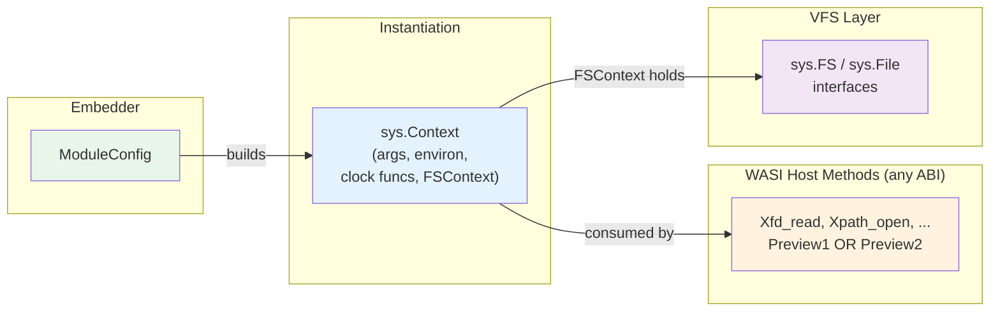

# Design Improvements 2: Configuration Abstraction — Decoupling WASI Consumption from Implementation

## Purpose

This document designs the foundational architectural change needed to improve reliability and security of `wasm2go-wasi-host`: *make the consumption of the WASI interface abstracted from the actual WASI interface implementation*. The design starts from concrete code and works upward, identifying wholesale sections of wazero code that are directly portable.

This is the first improvement to implement because all subsequent WASI host improvements — filesystem semantics, descriptor lifecycle, rights propagation, poll_oneoff evolution — depend on a clean abstraction between what the embedder configures and what the WASI methods consume.

## What stays unchanged

The comparison analysis established that several aspects of the current design are already correct and should NOT change:

| Area | Decision | Rationale |
|------|----------|-----------|
| `proc_exit` via panic/recover | Keep as-is | wazero independently chose the same pattern |
| Memory callback on every syscall | `func() []byte { return *mod.Xmemory().Slice() }` | Cleaner than wazero's runtime-level solution |
| Single-goroutine ownership | Keep `assertSingleOwner` | Correct for single-threaded wasm2go model |
| Capability-oriented preopens | Keep lexical confinement logic | Better documented than many runtimes |
| `fd_renumber` with invalidation | Keep the invalidation map approach | Handle the POSIX nuance correctly |

## The core problem, demonstrated

**Current consumption pattern.** Every WASI method body reaches directly into `State` fields that mix configuration (what the embedder chose) and runtime state (what accumulated during execution):

```go
// wasihost_fd.go — current code
func (s *State) Xfd_read(fd int32, iovsPtr int32, iovsCount int32, nreadPtr int32) int32 {
    entry := s.fds[fd]                        // runtime fd table
    if fd == StdinFD {
        if s.stdin != nil {                    // embedder config
            n, err = s.stdin.Read(mem[...])
        }
    }
    // ... io.Seeker type-switch on entry.file // filesystem type coupling
}
```

Three different concerns are accessed through one struct field: embedder config (`s.stdin`), runtime state (`s.fds`), and filesystem type assertions (`entry.file.(io.Seeker)`). There is no way to swap the filesystem model or the config format without changing every method body.

**The wazero consumption pattern.** In wazero, the WASI handler methods see only a `sys.Context`:

```go
// imports/wasi_snapshot_preview1/fs.go (wazero)
func fdReadFn(_ context.Context, mod api.Module, params []uint64) Errno {
    sysCtx := mod.(*wasm.ModuleInstance).Sys // sys.Context
    fsc := sysCtx.FS()                        // FSContext

    fe, ok := fsc.LookupFile(fd)              // runtime lookup: FileEntry
    n, errno := fe.File.Pread(buf, fe.File)   // abstracted File interface
}
```

The WASI method does NOT know whether the file came from `os.File`, `fs.FS`, a virtual filesystem, or a socket. It never references `stdin`/`stdout` as special cases. Stdio is just fd 0/1/2 populated at context-construction time as regular `FileEntry` values in the same `FileTable`.

## The architectural split



The WASI host methods never reference `ModuleConfig`. They consume `sys.Context`. The `FSContext` inside `Context` manages the fd table, with each entry pointing to a `sys.File` — the methods never touch `fs.FS` or `*os.File` directly.

## Phase 1: Port wazero's type definitions (zero risk)

Six files from wazero can be copied almost verbatim. They define types with zero dependencies on wazero internals. License attribution is required (Apache 2.0); place them in an `internal/wasi/` package.

### Group A: Core types — no dependencies, no code changes needed

| wazero source | Content | Lines to port | Notes |
|---------------|---------|---------------|-------|
| `experimental/sys/errno.go` | `Errno` type + constants (`EACCES`..`EROFS`) | ~72 | Drop `ENOTCAPABLE` if not used |
| `sys/stat.go` | `Stat_t`, `Inode`, `EpochNanos`, `NewStat_t` | ~100 | Already in separate package in wazero |
| `sys/clock.go` | `Walltime`, `Nanotime`, `Nanosleep`, `Osyield`, `ClockResolution` | ~22 | Function type aliases only |
| `experimental/sys/oflag.go` | `Oflag` type + `O_RDONLY..O_TRUNC` | ~60 | Maps directly to WASI oflags |
| `experimental/sys/dir.go` | `Dirent`, `FileType`, `DirFile` embeddable struct | ~60 | Dirent is needed for `Readdir` |
| `internal/descriptor/table.go` | `Table[Key, Item]` — sparse-bitmap fd management | ~130 | Generics; zero dependencies |

**Total: ~444 lines of type definitions that carry no execution risk.**

### Group B: File/FS interfaces — need package-level adjustment

| wazero source | Content | Lines | Notes |
|---------------|---------|-------|-------|
| `experimental/sys/fs.go` | `FS` interface (OpenFile, Stat, Mkdir, Rename, ...) | ~165 | Change `Errno` to local type |
| `experimental/sys/file.go` | `File` + `PollableFile` interfaces | ~200 | Change `Errno`, `sys.Inode`, `sys.Stat_t` |
| `experimental/sys/unimplemented.go` | `UnimplementedFS`, `UnimplementedFile` | ~120 | Change import paths |

**These three files define the VFS abstraction contract.** The `FS` interface is the WASI-native filesystem, and `File` is the open-file handle. Both use `Errno` instead of Go errors throughout. Embedding `UnimplementedFS` / `UnimplementedFile` gives forward compatibility: new methods added later don't break existing implementations.

## Phase 2: Port wazero's VFS adapters (~600 lines, low risk)

These adapt `fs.FS`, `os.File`, and host directories to the `FS`/`File` interfaces. They replace the current `FSFileWrap`, `osFile`, and `DirEntriesFile` adapters.

### Files to port

| wazero source | Content | What it replaces |
|---------------|---------|-----------------|
| `internal/sysfs/dirfs.go` | `DirFS` — writable host directory → `sys.FS` | Current `mountEntry.hostRoot` dispatch |
| `internal/sysfs/readfs.go` | `ReadFS` — wraps any `FS` to deny writes | Current `mountEntry.readonly` checks distributed across methods |
| `internal/sysfs/adapter.go` | `AdaptFS` — `fs.FS` → `sys.FS` (read-only by nature) | Current `FSFileWrap` + overlay fallback in `path_open` |
| `internal/sysfs/file.go` | `OpenFSFile`, `OpenOSFile`, `fsFile`, `stdioFile` | Current `FSFileWrap`, `osFile` ad-hoc adapters |
| `internal/sysfs/osfile.go` | `osFile` — `*os.File` → `File` with cached stat | Current manual `(io.Seeker)` type assertions |

### Why this is low risk

These adapters **already pass wasi-testsuite** in wazero. They handle edge cases this project currently has workarounds for:

- **Readdir re-open**: On Windows, directories must be re-opened before `Readdir` to see new files. `osFile` does this transparently.
- **O_APPEND**: `SetAppend` correctly re-opens the underlying file when append mode changes.
- **Dot entries**: wazero's `DirentCache` synthesizes `.` and `..` correctly with inode propagation.
- **`fs.FS` fallback for non-writable paths**: `AdaptFS.OpenFile` maps `fs.FS.Open` through proper errno translation, which the current code does manually in `path_open`.

### Current code that becomes dead

After porting these adapters, the following types can be removed:

- `FSFileWrap` — replaced by `sysfs.fsFile` / `AdaptFS`
- `DirEntriesFile` — replaced by `DirentCache` in `sys.FSContext`
- `osFile` (current) — replaced by `sysfs.osFile`
- `synthDirEntry` — replaced by `sys.Dirent` synthesis in `DirentCache`
- `wasiDirInfo` — replaced by `sys.Stat_t`

## Phase 3: Port wazero's FSContext (~450 lines, medium risk)

This is the core runtime state that replaces the current manual fd-table logic.

### Files to port

| wazero source | Content | |
|---------------|---------|---|
| `internal/sys/fs.go` | `FSContext`, `FileEntry`, `FileTable`, `DirentCache`, `InitFSContext` | ~370 lines |
| `internal/sys/lazy.go` | `lazyDir` — defers preopen directory open until first access | ~95 lines |
| `internal/sys/stdio.go` | `StdinFile`, `writerFile`, `noopStdinFile`, `noopStdoutFile` | ~150 lines |

### `FSContext` is a drop-in fd manager

```go
type FSContext struct {
    openedFiles FileTable  // descriptor.Table[int32, *FileEntry]
}
```

Methods:

- `LookupFile(fd int32) (*FileEntry, bool)` — replaces `s.fds[fd]` with bounds/validity checks
- `OpenFile(fs sys.FS, path string, flag Oflag, perm fs.FileMode) (int32, Errno)` — replaces `storeOpenedFD` + `allocFD`
- `CloseFile(fd int32) Errno` — replaces inline close in `Xfd_close`
- `Renumber(from, to int32) Errno` — replaces `fd_renumber` manual logic
- `Close() error` — bulk close on module teardown

### DirentCache replaces readdir manual snapshot logic

The current `Xfd_readdir` has ~130 lines of inline snapshot management, dot-entry synthesis, and inode computation. `DirentCache.Read(pos, n)` handles all of this:

```go
// Before (current): ~130 lines in Xfd_readdir
if cookie == 0 {
    entry.readdirSnapshot = nil
    // ... re-read directory, synthesize . and .., compute inodes ...
}

// After: ~20 lines
cache, errno := fe.DirentCache()
dirents, errno := cache.Read(uint64(cookie), uint32(bufLen/24))
// write dirents to guest memory
```

## Phase 4: Introduce ModuleConfig and runtime Context

This is where the consumption abstraction actually takes shape. The WASI methods stop touching embedder configuration directly and instead consume a `Context` that was built from `ModuleConfig` once at instantiation.

### Step 4a: Define clock/rand function types (zero cost — already in Phase 1)

```go
// internal/wasi/clock.go (from wazero sys/clock.go)
type Walltime func() (sec int64, nsec int32)
type Nanotime func() int64
type Nanosleep func(ns int64)
type Osyield  func()
type ClockResolution uint32
```

### Step 4b: Create ModuleConfig (immutable builder)

This replaces all current `Option func(*State)` functions. The config is immutable — each `WithXxx` returns a copy. Since this is a new library, there is no backward-compatibility concern; the functional-option pattern is removed entirely in favor of a chained config builder.

```go
package wasihost

// ModuleConfig is an immutable configuration for one wasm2go module instance.
// It is NOT specific to any WASI specification — it defines resources
// (stdio, args, env, filesystems, clocks) that any ABI can consume.
//
// Zero values mean "no access" / "fake" (secure by default).
type ModuleConfig struct {
    name            string
    args            [][]byte
    environ         [][]byte
    stdin           io.Reader
    stdout          io.Writer
    stderr          io.Writer
    randSource      io.Reader
    walltime        Walltime
    walltimeRes     ClockResolution
    nanotime        Nanotime
    nanotimeRes     ClockResolution
    nanosleep       Nanosleep
    osyield         Osyield
    fsConfig        *FSConfig
}

func NewModuleConfig() *ModuleConfig {
    return &ModuleConfig{}
}

// WithXxx methods return a shallow copy with the field changed (immutability).
// Note: slices (args, environ) are deep-copied in clone().
func (c *ModuleConfig) WithArgs(args ...string) *ModuleConfig {
    ret := c.clone()
    ret.args = stringsToByteSlices(args)
    return ret
}

func (c *ModuleConfig) WithEnv(key, value string) *ModuleConfig {
    ret := c.clone()
    ret.environ = append(ret.environ, []byte(key+"="+value))
    return ret
}

func (c *ModuleConfig) WithStdin(r io.Reader) *ModuleConfig { ... }
func (c *ModuleConfig) WithStdout(w io.Writer) *ModuleConfig { ... }
func (c *ModuleConfig) WithStderr(w io.Writer) *ModuleConfig { ... }
func (c *ModuleConfig) WithFS(fsConfig *FSConfig) *ModuleConfig { ... }
func (c *ModuleConfig) WithWalltime(w Walltime, res ClockResolution) *ModuleConfig { ... }
func (c *ModuleConfig) WithNanotime(n Nanotime, res ClockResolution) *ModuleConfig { ... }
func (c *ModuleConfig) WithNanosleep(ns Nanosleep) *ModuleConfig { ... }
func (c *ModuleConfig) WithRandSource(r io.Reader) *ModuleConfig { ... }

func (c *ModuleConfig) clone() *ModuleConfig {
    ret := *c
    // Deep-copy slices to maintain immutability
    if len(c.args) > 0 {
        ret.args = make([][]byte, len(c.args))
        copy(ret.args, c.args)
    }
    if len(c.environ) > 0 {
        ret.environ = make([][]byte, len(c.environ))
        copy(ret.environ, c.environ)
    }
    return &ret
}
```

### Step 4c: Create FSConfig (partially from wazero fsconfig.go)

```go
package wasihost

type FSConfig struct {
    fs         []sys.FS      // preopened filesystems
    guestPaths []string       // corresponding guest paths
    pathIndex  map[string]int // guestPath → fs index for dedup
}

func NewFSConfig() *FSConfig { ... }

func (c *FSConfig) WithDirMount(dir, guestPath string) *FSConfig {
    // Creates a writable DirFS from the host directory
    return c.WithSysFS(sysfs.DirFS(dir), guestPath)
}

func (c *FSConfig) WithReadOnlyDirMount(dir, guestPath string) *FSConfig {
    // Creates a read-only DirFS from the host directory
    return c.WithSysFS(&sysfs.ReadFS{FS: sysfs.DirFS(dir)}, guestPath)
}

func (c *FSConfig) WithFSMount(fs fs.FS, guestPath string) *FSConfig {
    // Adapts an fs.FS to sys.FS (read-only)
    return c.WithSysFS(&sysfs.AdaptFS{FS: fs}, guestPath)
}

func (c *FSConfig) WithSysFS(fs sys.FS, guestPath string) *FSConfig {
    // Internal: any sys.FS mount. Deduplicates by guestPath.
    ...
}
```

### Step 4d: Build runtime Context from ModuleConfig

```go
// internal/wasi/context.go (patterned after wazero internal/sys/sys.go)
type Context struct {
    // Immutable, built from ModuleConfig
    args       [][]byte
    environ    [][]byte
    argsSize   uint32
    environSize uint32

    // Clock functions (fake by default)
    walltime    Walltime
    nanotime    Nanotime
    nanosleep   Nanosleep
    osyield     Osyield

    // Filesystem
    fsc         FSContext

    // Random source
    randSource  io.Reader
}

func NewContext(mem func() []byte, config *ModuleConfig) *Context {
    ctx := &Context{...}
    ctx.InitFSContext(
        config.stdin, config.stdout, config.stderr,
        config.fsConfig.preopens(),
    )
    return ctx
}
```

## The refactored State

After all phases, `State` looks like:

```go
type State struct {
    mem    func() []byte       // unchanged — memory callback
    ctx    *wasi.Context        // replaces: fds, mounts, args, env, stdin, stdout, stderr, startTime
    trace  bool                 // unchanged
    assertOwner bool            // unchanged
    ownerGID    uint64          // unchanged
}
```

That's it. The 15-field struct becomes a 5-field struct. Everything that was config or runtime state moves to `Context`. The WASI methods consume `s.ctx`:

```go
// After — wasihost_fd.go
func (s *State) Xfd_read(fd int32, iovsPtr int32, iovsCount int32, nreadPtr int32) int32 {
    s.assertSingleOwner()
    fe, ok := s.ctx.FS().LookupFile(fd)
    if !ok {
        return wasiEBadf
    }
    mem := s.mem()
    var total uint32
    for i := int32(0); i < iovsCount; i++ {
        // fe.File.Read uses sys.File interface — no type switches needed
        n, errno := fe.File.Read(mem[bufPtr : bufPtr+bufLen])
        total += uint32(n)
        if errno != 0 {
            // ...
        }
    }
    binary.LittleEndian.PutUint32(mem[nreadPtr:], total)
    return wasiESuccess
}
```

No more `if fd == StdinFD`, no more `if s.stdin != nil`, no more `entry.file.(io.Seeker)` type switches. Stdio is just fd 0/1/2 with `sys.File` entries populated during `InitFSContext`.

## The public API

Since this is a new library with no backward-compatibility requirement, the functional-option pattern (`WithArgs`, `WithHostDirectoryPreopen`, etc.) is dropped entirely. The chained config builder is the only API:

```go
cfg := wasihost.NewModuleConfig().
    WithArgs("app").
    WithFS(wasihost.NewFSConfig().WithDirMount(hostDir, "/")).
    WithStdin(os.Stdin).
    WithStdout(os.Stdout)

state := wasihost.New(
    func() []byte { return *mod.Xmemory().Slice() },
    cfg,
)
```

The `wasm2go-run` template changes accordingly — the `New` call passes a single config object instead of a list of option functions. This also means the template no longer needs to conditionally emit `WithStdin`/`WithStdout` option lines; the config is built once and passed through.

## Integration notes for the path resolution boundary

Three decisions that affect how the ported code integrates with the existing path resolution and error handling.

### 1. Add `PathFor()` to the `sys.FS` interface

The path resolution logic in `wasihost_path_resolve.go` (~270 lines) needs to know the underlying host path for preopen mounts — it uses this for confinement checks, symlink following, and `EvalSymlinks` validation. `DirFS` has a `dir` field but it's unexported. The resolution functions currently reach into `s.mounts[i].hostRoot`; after the refactor they need to reach into the per-VFS equivalent.

Add one method to the `FS` interface (a one-line addition to the ported `experimental/sys/fs.go`):

```go
// PathFor returns the underlying host path for preopen resolution,
// or "" for virtual filesystems. Used by confinement logic.
PathFor() string
```

Implementations:
- `DirFS` → returns `d.dir`
- `ReadFS` → delegates to `r.FS.PathFor()`
- `AdaptFS` → returns `""`

This is the only interface change to ported wazero code. Everything else is used as-is.

### 2. Keep `mapOSError`, use `Errno` only inside the VFS layer

The current `mapOSError` function maps Go errors to `int32` WASI errno codes and is validated by 72 wasi-testsuite tests. wazero's `UnwrapOSError` maps `os.ErrPermission` → `EPERM` (63), while this project maps it → `EACCES` (2). Replacing the mapping would require re-auditing every syscall handler.

Strategy:
- Port the `Errno` type (uint16) and its constants into `internal/wasi/` for use within the VFS adapters (e.g., `ReadFS` returns `EROFS`).
- Keep `int32` as the return type of all WASI method signatures (`Xfd_read`, `Xpath_open`, etc.).
- Add a thin conversion at the VFS → WASI boundary:

```go
func errnoToWASI(e sys.Errno) int32 {
    switch e {
    case 0: return wasiESuccess
    case sys.EROFS: return wasiEROFS
    case sys.ENOSYS: return wasiENoSys
    case sys.EACCES: return wasiEAcces
    // ... etc
    }
}
```

- Keep `mapOSError` for translating Go errors in existing syscall handlers — it doesn't change.

### 3. No overlay fallback needed (clean-slate API)

The current `path_open` has a three-tier open strategy: try `os.OpenFile` on the host path, retry with a fallback path, then fall through to `fs.FS.Open` for read-only opens on writable mounts. Since this is a new library with no backward-compatibility requirement, this behavior is not preserved. A writable mount is backed by `DirFS` (host directory only, no `fs.FS` overlay). A read-only mount is backed by `AdaptFS` (wrapping `fs.FS`) or `ReadFS` (wrapping `DirFS`). The two are never combined on a single mount.

## Migration plan (sequential phases)

### Pre-implementation design decisions

Three specific choices that affect how the WASI methods look after refactoring:

**1. Use `Pread`/`Pwrite` everywhere, track offset on `FileEntry`.**

The current code manually seeks to `entry.offset` before every `Read`/`Write` call and updates the offset afterward. The ported `sys.File` interface has `Pread(buf, off)` and `Pwrite(buf, off)` — positioned I/O that bypasses the kernel file position. This eliminates `io.Seeker` type assertions, seeking errors, and the `O_APPEND` → seek-to-end → write → seek-to-current dance. Offset tracking becomes purely arithmetic in the WASI method body:

```go
// After — Xfd_read
n, errno := fe.File.Pread(mem[bufPtr:bufPtr+bufLen], fe.Offset)
fe.Offset += int64(n)

// After — Xfd_write with append
if fe.Flags&fdFlagsAppend != 0 {
    st, _ := fe.File.Stat()
    fe.Offset = st.Size
}
n, errno := fe.File.Pwrite(data, fe.Offset)
fe.Offset += int64(n)
```

Add an `Offset int64` field to the ported `FileEntry` struct.

**2. Rights fields live on `FileEntry`, not on the VFS interface.**

The current `fdEntry` carries `RightsBase` and `RightsInheriting`. These are WASI Preview1 concerns — they don't belong on the VFS `sys.File` interface, which is WASI-agnostic. But they need to travel with each fd entry so that `errnoIfFDRightsMissing` and `pathOpenStoredRights` can access them. Add two uint64 fields to the ported `FileEntry` struct.

```
Phase 1: Copy type definitions          → 0 test breakage, just new files
Phase 2: Copy VFS adapters              → new files, dead code not yet removed
Phase 2.5: Add internal/wasi/context.go → new Context type, not wired yet
Phase 3: Add FSContext into Context     → internal/wasi/fsctx.go
Phase 4: Refactor State                 → swap fd table, mounts → ctx.FS()
Phase 4.5: Refactor one WASI method     → Xfd_read as proof-of-concept
Phase 5: Refactor remaining methods     → one-by-one, tests confirm each
Phase 6: Remove dead code               → FSFileWrap, DirEntriesFile, old osFile
```

At no point should all 72 wasi-testsuite tests not pass.

## Rationale for the migration order

The migration is ordered so that mechanical, low-risk steps come first and the risky parts — refactoring 40 WASI method bodies — happen only after the supporting types, interfaces, and adapters are in place and testable.

1. **Configuration is the foundation.** Everything the WASI methods do — reading fd 0, writing fd 1, opening paths — depends on *which resources are configured*. The runtime `Context` must exist before any method can consume it.

2. **The VFS interfaces and adapters are mechanical.** They are type definitions and OS wrappers. They can be copied from wazero with minimal changes because they don't depend on this project's `State` at all. Porting them first gives the method refactoring a stable target to code against.

3. **The consumption pattern is where the risk lives.** Refactoring 40 WASI method bodies to use `ctx.FS().LookupFile(fd)` instead of `s.fds[fd]` is the bottleneck. Each method has subtly different error handling, offset tracking, and rights checking. Everything in Phases 1-3 exists to make Phase 5's refactors as mechanical as possible — each method should read the same before and after except for the fd lookup and file I/O call sites.

4. **Tests stay green throughout.** Each phase is independently testable. The wasi-testsuite passes after every step. This is possible because the old `State` fields and the new `Context` coexist during the transition — methods are migrated one at a time, not all at once.

## Portable code inventory

Summary of wazero code that can be ported directly:

| Package | Files | Approx. lines | Risk | Dependency chain |
|---------|-------|---------------|------|-----------------|
| `internal/wasi/` | `errno.go`, `oflag.go`, `dir.go`, `stat.go`, `clock.go` | ~300 | None | Zero deps |
| `internal/wasi/` | `fs.go`, `file.go`, `unimplemented.go` | ~485 | None | Depends on errno/stat/oflag only. **One method added**: `PathFor() string` to `FS` interface |
| `internal/wasi/` | `table.go` (from `descriptor/table.go`) | ~130 | None | Zero deps |
| `internal/wasi/sysfs/` | `dirfs.go`, `readfs.go`, `adapter.go`, `file.go`, `osfile.go` | ~800 | Low | Depends on FS/File interfaces |
| `internal/wasi/` | `fsctx.go` (from `internal/sys/fs.go`), `lazy.go`, `stdio.go` | ~615 | Medium | Depends on FS/File + table |

**Total: ~2,330 lines of battle-tested code from a project that passes wasi-testsuite on Linux, macOS, and Windows.** The lines-to-port count is substantially lower than writing this from scratch, and the risk is lower because edge cases have already been discovered and fixed.

## Portable test inventory

The ported code should arrive with its tests. wazero's test suite for these components can be ported in tiers:

### Tier 1: Mechanical ports (~230 test lines, zero fixtures needed)

| wazero source | Content | Lines | Adaptation needed |
|---------------|---------|-------|-------------------|
| `internal/descriptor/table_test.go` | Insert, Lookup, Delete, Range, size-of-table, benchmarks | ~180 | Swap `require` for `testing.T` assertions. Also port `export_test.go` (~10 lines) for `Masks()`/`Items()` accessors |
| `experimental/sys/error_test.go` | `UnwrapOSError` for nil, `os.PathError`, `os.LinkError`, wrappers | ~50 | Already uses only `testing.T`; no change needed |

These two test files validate the `Table` data structure and the `Errno` error unwrapping. They carry zero filesystem dependencies and run in milliseconds.

### Tier 2: Shared test fixtures (~110 lines, one-time port)

| wazero source | Content | Lines | Why port |
|---------------|---------|-------|----------|
| `internal/fstest/fstest.go` | `FS` (in-memory `fstest.MapFS` with 10 test files and directories), `WriteTestFiles` (write fixture to a temp dir for `os.DirFS`-backed tests) | ~140 | Every adapter and FSContext test in wazero uses this fixture. Porting it once makes the Tier 3 tests work with only import-path changes |
| `internal/fstest/times_notwindows.go` | `RequireTimes` — platform-specific timestamp assertion helper | ~5 | Used by `testStat` and `testLstat` shared helpers |
| `internal/fstest/times_windows.go` | Same for Windows | ~5 | |

The fixture defines well-known files (`animals.txt`, `sub/test.txt`, `dir/-`, `dir/a-`, `dir/ab-`) with known modes, sizes, and modification times. Edge-case names like `dir/-` exercise boundary conditions in `Readdir`.

### Tier 3: Adapter and FSContext tests (~1,100 test lines, medium adaptation)

| wazero source | Content | Lines | What it validates |
|---------------|---------|-------|-------------------|
| `internal/sysfs/readfs_test.go` | `ReadFS` denies `Mkdir`, `Chmod`, `Rename`, `Rmdir`, `Unlink`, `Utimens`; delegates `Open`/`Stat`/`Readlink` correctly | ~230 | The critical `EROFS` enforcement that fixes silent-success bugs |
| `internal/sysfs/adapter_test.go` | `AdaptFS` returns `ENOSYS` on all mutation operations; delegates `Open`/`Stat` correctly | ~260 | `fs.FS` → `sys.FS` translation correctness |
| `internal/sys/stdio_test.go` | `StdinFile` read/poll for pollable and non-pollable readers; `noopStdinFile` and `noopStdoutFile` behavior | ~140 | Stdio as regular `FileEntry` values |
| `internal/sys/fs_test.go` | `FSContext.OpenFile`, `LookupFile`, `CloseFile`, `Renumber`, `Close` across `DirFS`, `ReadFS`, `AdaptFS`, `embed.FS`, `fstest.MapFS` | ~350 | The fd table that replaces `s.fds[]` |
| `internal/sys/sys_test.go` | Argument and environment validation, max-count enforcement, NUL character rejection | ~120 | Input validation for `args_get`/`environ_get` |

### Tier 4: Shared test helper functions (~200 test lines, extract to a `testutil` package)

| wazero source | Content | Lines | What it provides |
|---------------|---------|-------|------------------|
| `internal/sysfs/sysfs_test.go` | `testLstat`, `testStat`, `testOpen_Read`, `testOpen_O_RDWR`, `testReadlink` | ~200 | Standard compliance checks shared by `readfs_test`, `adapter_test`, and `dirfs_test`. These verify inode presence, file mode, size, and symlink handling against the fixture |

These helpers are called by the Tier 3 tests. Rather than duplicating them, extract them into `internal/wasi/sysfs/testutil/` so each adapter package can import and call them against its own implementation.

### What NOT to port

| wazero source | Lines | Reason to skip |
|---------------|-------|----------------|
| `internal/sysfs/file_test.go` | 1,248 | Integration tests for `osFile` with platform-specific edge cases (reopen, nonblock, append). Too large; the wasi-testsuite already exercises file I/O end-to-end |
| `internal/sysfs/dirfs_test.go` | 773 | Integration tests for `DirFS`. wasi-testsuite covers this via path resolution and directory operations |
| `internal/sysfs/sysfs_test.go` (remaining) | ~180 | Test matrix `Run` loop infrastructure — wazero-specific pattern |
| `internal/sysfs/*_windows_test.go` | ~50 | Windows-specific; this project does not target Windows |
| `internal/descriptor/bench_test.go` | ~40 | Benchmark; not a correctness test |

### Total test porting summary

| Tier | Lines | Effort |
|------|-------|--------|
| Tier 1: Mechanical | ~230 | Swap import paths and assertion library |
| Tier 2: Fixtures | ~150 | One-time write; enables all Tier 3 tests |
| Tier 3: Adapter/FSContext | ~1,100 | Swap import paths, remove `require` and `fstest` packages |
| Tier 4: Shared helpers | ~200 | Extract to `sysfs/testutil/` |

**Total: ~1,680 test lines ported.** These tests exercise the exact code paths that the WASI methods will consume (fd table lookups, file I/O, error propagation), providing confidence *before* any WASI method is refactored. Combined with the existing 72 wasi-testsuite integration tests, this gives a strong safety net for Phase 5's method-by-method refactoring.

## Error handling as a byproduct

Proper configuration abstraction directly fixes the silent-success problem identified in the comparison analysis. When error behavior is enforced at the VFS implementation level rather than through ad-hoc checks in each WASI method body, it becomes correct by construction:

| Current | Why it happens | Fix |
|---------|---------------|-----|
| `fd_filestat_set_size` returns ESUCCESS on read-only | `mountEntry.readonly` is checked ad-hoc in each method | `ReadFS` wrapper returns EROFS from its `Utimens` / `Truncate` methods — enforced at the VFS level |
| `fd_advise` returns ESUCCESS | No VFS method to call | `UnimplementedFS` returns ENOSYS by default; override only if implementing |
| `fd_datasync` returns ESUCCESS on non-sync-capable | Manual type assertion in method body | `UnimplementedFile.Datasync()` returns 0 (matches wazero's documented no-op semantics for fake filesystems) |

The error behavior becomes a property of the VFS implementation, not of the WASI method body. A `ReadFS` always denies writes. An `AdaptFS` always returns ENOSYS for mutations. The WASI method just propagates the errno — no manual audit of 40 method bodies required.

## Appendix: Key insights from wazero RATIONALE.md

The wazero rationale document directly addresses why configuration must be decoupled from WASI:

> "This instability implies a need to transition between WASI specs, which places wazero in a position that requires decoupling. For example, if code uses two different functions to call `fd_write`, the underlying configuration must be centralized and decoupled. Otherwise, calls using the same file descriptor number will end up writing to different places."

And on why immutable configuration matters:

> "Making configuration immutable allows them to be safely used in any goroutine."

And on why config is flat and simple:

> "We default to a flat structure to encourage simplicity. If we eagerly broke out all possible configurations into sub-types (e.g. ClockConfig), it would be hard to notice configuration sprawl."

These three principles — decoupling from spec, immutability, and flatness — directly inform the design above.